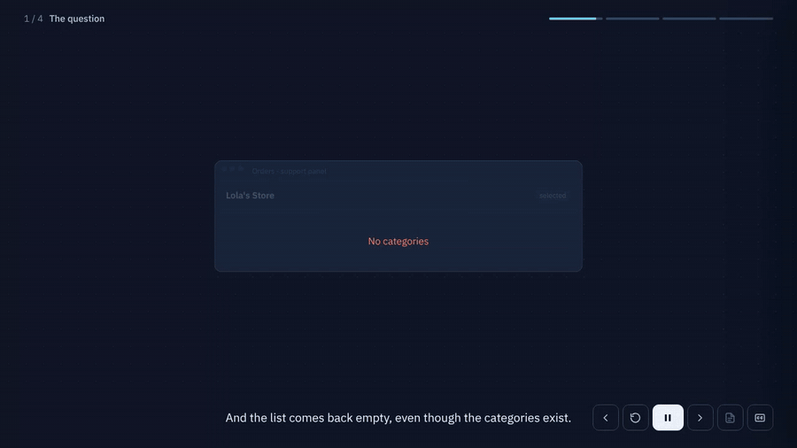
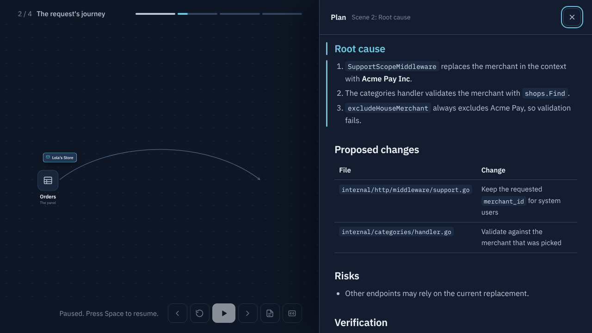

# Plan Tour

**Turn a Claude Code plan into an animated, narrated story you can watch, interrupt and steer.**

Plans are walls of text. Plan Tour has Claude explain them the way a good explainer video does: a concrete case, step by step, with the screen showing exactly what the voice is talking about. Claude designs every scene itself, choosing the picture that fits the idea (a flow, a mock of the real screen, a before/after, a timeline, a zoom into code), and checks each one from a snapshot before you see it.



Want to see it without installing anything? **[Watch the demo in your browser](https://jorgelhd94.github.io/plan-tour/demo.html)** (Edge gives the most natural voice). To keep a copy, open [`docs/demo.html`](docs/demo.html), use **Download raw file** and open the downloaded file; saving the GitHub page itself won't work.

## Features

- **Explainer-style storytelling.** One protagonist, four beats (the question, the journey, the twist, the fix), short sentences and everyday nicknames for technical pieces.
- **Scenes designed for the idea, not a template.** Each scene is free-form HTML/SVG on a 16:9 canvas, so Claude can draw whatever explains it best, with an optional kit of boxes, labels, notes, arrows and code blocks.
- **The screen follows the voice.** Every narrated sentence makes something happen: elements appear, move along paths, change labels or color, get highlighted, or the camera zooms in, in sync with the audio.
- **Claude reviews its own scenes.** Before publishing, each scene is rendered in a headless Edge/Chrome: overlaps, cut-off elements, text that doesn't fit and arrows crossing other elements are detected automatically, and Claude looks at a snapshot of every step to fix what doesn't read well.
- **No waiting.** Scenes are generated one at a time, so the tour starts after the first scene while Claude writes the rest.
- **Interrupt from the chat.** Ask a question, say `more detail`, `faster`, `skip` or correct the plan, and the tour rewinds and continues from there with a new scene.
- **The written plan, side by side.** Press **P** to read the full plan, rendered as Markdown. The section the current scene is telling is highlighted.
- **Speaks your language.** Everything you see and hear in the tour is in the language you use with Claude, with a matching neural voice.
- **Three depths.** Quick (3 scenes), Standard (4–6) or Deep (6–10, with code). Claude asks once before starting.
- **Stays out of your project.** Nothing is written to your repository: tour files live in your system's temp folder, and it works in plan mode.



## Requirements

- [Claude Code](https://code.claude.com)
- Python 3.9 or newer
- [edge-tts](https://github.com/rany2/edge-tts): `python -m pip install edge-tts`
- Microsoft Edge, Google Chrome or Chromium (to watch the tour and for the automatic visual review)

Tested on Windows with the Claude desktop app. macOS and Linux should work but are less tested; reports are welcome.

## Install

Inside Claude Code:

```
/plugin marketplace add jorgelhd94/plan-tour
/plugin install plan-tour@plan-tour
```

Then install the voice engine if you don't have it:

```
python -m pip install edge-tts
```

## Usage

After Claude Code proposes a plan, ask for a tour:

```
/plan-tour:tour
```

or just say it in your own words, for example *"give me a plan tour"* or *"hazme un tour del plan"*. You can set the depth and topic directly:

```
/plan-tour:tour deep
/plan-tour:tour quick how the payment retries work
```

Claude opens the player in your browser. Press **Start**, then:

| Key | Action |
|---|---|
| Space | Pause or resume |
| ← → | Previous or next scene |
| R | Replay the scene |
| P | Show or hide the written plan |
| C | Show or hide captions |

To steer the tour, write in the Claude chat at any time: a question, `more detail`, `faster`, `skip`, `stop`, or a correction to the plan.

### Fewer approval prompts

Claude Code may ask for approval each time the tour engine runs. To allow it permanently, ask Claude to run, or run yourself:

```
python <path-to-plugin>/skills/tour/scripts/tour.py allow
```

It adds a narrow rule for this script to `~/.claude/settings.json` and saves a backup of the previous file.

## Configuration

| Variable | Purpose |
|---|---|
| `PLAN_TOUR_VOICE` | Any edge-tts voice, overriding the one picked for your language. List them with `tour.py voices --lang es`. |
| `PLAN_TOUR_RATE` | Speaking rate, for example `+10%` or `-5%`. |
| `PLAN_TOUR_DIR` | Folder for tour files. Defaults to `<system temp>/plan-tour/<project>-<hash>`. |
| `PLAN_TOUR_BROWSER` | Path to Edge/Chrome/Chromium for the visual review, if it isn't found automatically. |

## How it works

```
Claude Code ── tour.py draft ──▶ headless browser ──▶ layout issues + snapshot ──▶ Claude fixes
            ── tour.py plan / outline / add ──▶ manifest.json + audio (temp folder)
                                                     │
                       tour.py serve (localhost) ◀───┘
                                │
                         browser player ── reports the scene you're on ──▶ Claude reads it with tour.py status
```

1. Claude publishes the written plan verbatim, then an outline: the case and the scene titles.
2. Each scene is free-form markup plus a list of narrated sentences, each with what changes on screen. Claude sends it as a draft first: `tour.py` renders every step in a headless browser, reports layout problems and saves a snapshot that Claude reviews and fixes.
3. Publishing synthesizes each sentence with edge-tts (cached, so unchanged sentences are free) and appends the scene to the manifest.
4. The player polls the manifest, plays scenes as they arrive and animates each sentence's changes in sync with its audio.
5. When you interrupt, Claude checks which scene you're watching, rewinds and publishes new scenes from there.

## Privacy and limitations

- **Narration is sent to Microsoft's text-to-speech service.** edge-tts uses the online voice service behind Microsoft Edge's read-aloud feature. It isn't an official API and needs no account, but the narrated sentences leave your machine, and the service could change or stop working without notice. If a clip fails, the player falls back to your browser's built-in voice. Don't use it for code you can't share with a third-party service.
- The plan text and the code snippets shown in the tour stay local: they're served only on `127.0.0.1`.
- Designing and reviewing each scene takes time and tokens: expect roughly the length of a scene's narration between scenes, mostly hidden while you watch the previous one.
- How good a tour is depends on Claude following the storytelling and design guidance in the skill. If a tour drifts from the plan or a scene doesn't read well, say so in the chat and it will fix it.

## License

[MIT](LICENSE). Bundled fonts and libraries keep their own licenses, see [THIRD_PARTY_NOTICES.md](THIRD_PARTY_NOTICES.md).
